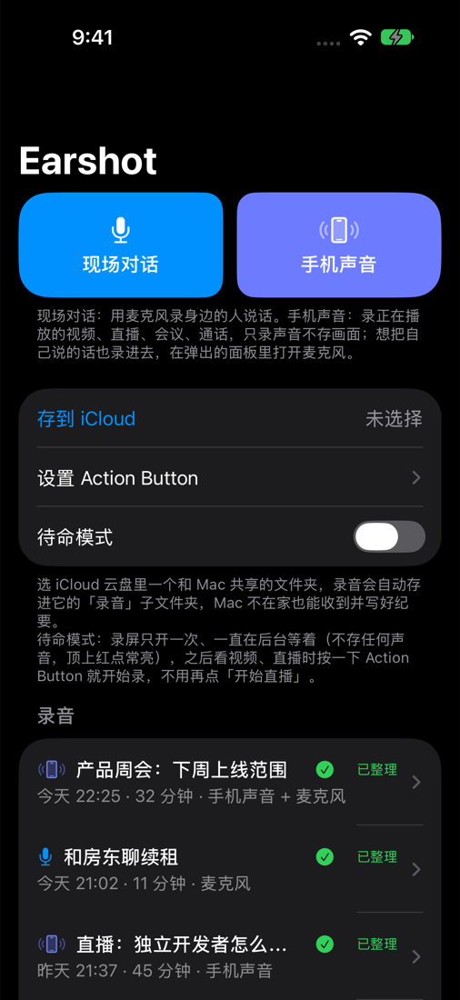
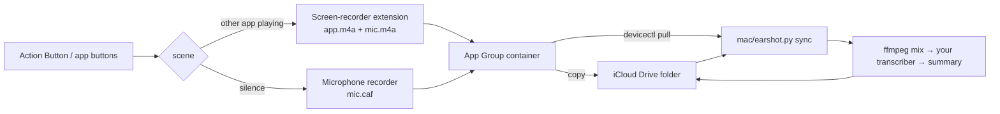

English · [简体中文](README.zh-CN.md)

# Earshot — record any iPhone app's audio, get the transcript and summary on your Mac

Earshot is an **audio-only iPhone recorder**: one press of the Action Button records either the
conversation around you or the sound of whatever your iPhone is playing — a live stream, a video, a
Zoom/Tencent Meeting, a WeChat call — without saving any video. A small Mac script picks the recordings up
from iCloud, transcribes them with the tool you choose, and writes a summary that fits the scene.

[](https://github.com/risingjerry/earshot-iphone-audio-recorder/actions/workflows/ci.yml)
[](LICENSE)


<p align="center"></p>

It is like Audio Hijack for the iPhone, built on Apple's public screen-recording (ReplayKit) extension.

## Quick start

You need a Mac with Xcode 26+ and [XcodeGen](https://github.com/yonaskolb/XcodeGen), an iPhone on iOS 26+,
and an Apple ID signed in to Xcode — a free Personal Team is enough.

```sh
git clone https://github.com/risingjerry/earshot-iphone-audio-recorder.git earshot && cd earshot
cp config.example.env config.local.env   # your team ID, a bundle-ID prefix, your iPhone's UDID
make ios-install                          # builds, signs, installs and opens Earshot
```

On the phone: tap **手机声音** (phone sound), pick Earshot in Apple's sheet, tap **Start Broadcast**, then play
something in any app. Tap again to stop — the recording is in the list, playable and shareable.

The app's interface is in Chinese; this README explains every control.

## What it does

- **Two scenes, one button.** 现场对话 (*conversation*) records the microphone; 手机声音 (*phone sound*) records what
  the phone plays, optionally with your microphone mixed in.
- **Action Button picks the scene.** If another app is playing sound, it records that app; if not, it starts a
  conversation recording right away, with a Live Activity timer in the Dynamic Island. Press again to stop.
- **待命模式 (standby): truly one press.** Start the screen recorder once; it then waits all day without
  storing anything, and each Action Button press starts or stops a recording — no sheet, no tap.
- **Audio only, crash-safe.** Video frames are dropped untouched; audio is AAC, flushed every 10 seconds
  (about 29 MB per hour), so a killed recording keeps all but the last seconds.
- **Lands on your Mac by itself.** Each recording is copied to an iCloud Drive folder you pick; the Mac sync also
  works over the local network with `xcrun devicectl`.
- **Summaries that fit the scene.** Conversations get *who said what / agreements / to-dos*; videos and live
  streams get *what was covered / quotes worth keeping*; online meetings and calls are detected as such.

## How it works



The iPhone app has no network code. Everything it writes, and everything the Mac writes back, is described in
[`docs/CONTRACT.md`](docs/CONTRACT.md).

## Set up the Mac side

Requirements: Python 3.11+, ffmpeg, and a transcription command. Summaries use the
[Codex CLI](https://github.com/openai/codex) by default; any command can replace it.

```sh
python3 mac/earshot.py init-config   # writes ~/.config/earshot/config.json
$EDITOR ~/.config/earshot/config.json
python3 mac/earshot.py sync          # process finished recordings once
make mac-install                     # launchd job: every 10 minutes and whenever the iCloud folder changes
```

| Setting | Meaning | Default |
|---|---|---|
| `transcribe_cmd` | **Required.** Command list with `{audio}` and `{out_dir}`; must write one `.md` transcript (a `.srt` is optional). Local example: [`examples/transcribe-whisper.sh`](examples/transcribe-whisper.sh) | — |
| `icloud_dir` | The `录音` folder inside the iCloud folder you picked in the app | `~/Library/Mobile Documents/com~apple~CloudDocs/Earshot/录音` |
| `device`, `app_group` | Your iPhone's UDID and `group.<prefix>.earshot`, to also pull over Wi-Fi/cable | off |
| `output_dir` | Where recordings pulled with devicectl are delivered | `~/Documents/Earshot` |
| `summary_cmd` / `summary_model` | Replace the Codex summary, or `[]` for none | Codex CLI |

Environment variables `EARSHOT_DEVICE`, `EARSHOT_APP_GROUP`, `EARSHOT_ICLOUD_DIR`, `EARSHOT_OUTPUT_DIR` and
`EARSHOT_CONFIG` override the file. Credentials never go in the config: your transcriber reads its own key.

Each recording folder ends up with `纪要.md` (summary), `文字稿.md` (timestamped transcript), `文字稿.srt` if
your transcriber makes one, and the original audio.

## Use with Claude Code, Codex and other agents

The repo ships an agent guide ([`AGENTS.md`](AGENTS.md)) and a skill that teaches an agent to find, sync and
quote your recordings:

```sh
npx skills add risingjerry/earshot-iphone-audio-recorder
# or: cp -r skills/earshot ~/.claude/skills/
```

Then ask, for example:

- "What did we agree on in the meeting I recorded this afternoon?"
- "Sync my phone recordings and summarize the last live stream."
- "Why does yesterday's recording have no transcript?"

## Limitations

- **Recording another app's sound needs one tap per session.** Apple requires the person to confirm every
  screen-recording session; no app can start one by itself. Standby mode keeps one session open so the Action
  Button works with a single press, at the cost of the red recording indicator staying on and some battery.
  The Control Center screen-record button does **not** remember Earshot as its target (tested on iOS 27).
- **Free Apple IDs sign for 7 days and allow 3 sideloaded apps per device.** `make ios-resign-job` re-signs
  every 4 hours while the phone is reachable.
- **iOS 26 or later**, iPhone only. Apps that protect their content (DRM video) may record as silence.
- Recording calls and meetings can require everyone's consent where you live. Ask first.

## FAQ

### Can an iPhone record the audio of another app, like Audio Hijack on Mac?
Yes, through Apple's screen-recording (ReplayKit) broadcast extension, which hands the extension the
system's playback audio. Earshot keeps only that audio and drops the video.

### Can it record WeChat calls, Zoom or Tencent Meeting on iPhone?
Yes — in testing it recorded WeChat voice and video calls, Tencent Meeting and Douyin live streams. Turn on the
microphone in Apple's sheet to include your own voice.

### Why do I still have to tap "Start Broadcast"?
Apple requires a person to start every screen-recording session. Turn on standby mode to tap once per session
instead of once per recording.

### Does Earshot upload my audio anywhere?
No. The iPhone app has no network code. Audio reaches your Mac only through your own iCloud Drive folder or a
local `devicectl` pull; what happens next depends on the transcription command you configure.

### Do I need a paid Apple Developer account?
No. A free Apple ID in Xcode can install it; the signature lasts 7 days, so keep the re-sign job running.

### How do I get a transcript and summary for each recording automatically?
Set `transcribe_cmd` in `~/.config/earshot/config.json` and run `make mac-install`; new recordings are processed
within ten minutes, or right away when they arrive in the iCloud folder.

## Uninstall

Delete the app on the iPhone, then on the Mac:

```sh
mac/uninstall-launchd.sh
launchctl bootout gui/$(id -u)/dev.earshot.resign; rm -f ~/Library/LaunchAgents/dev.earshot.resign.plist
rm -rf ~/.config/earshot "~/Library/Application Support/earshot"
```

Your recordings stay in the iCloud folder until you delete them.

## Contributing, security, license

[Contributing](CONTRIBUTING.md) · [Security policy](SECURITY.md) · [MIT License](LICENSE)

If Earshot saved you a meeting's worth of notes, a ⭐ helps others find it.

[](https://star-history.com/#risingjerry/earshot-iphone-audio-recorder&Date)
