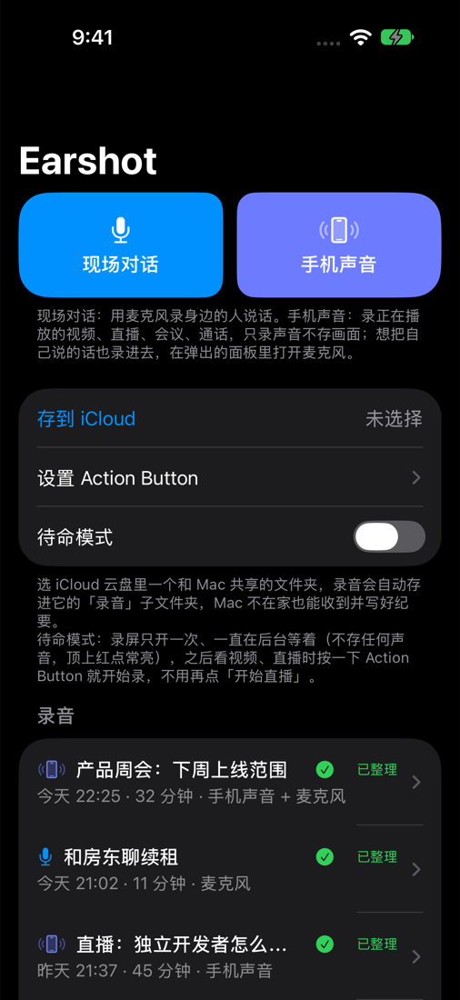
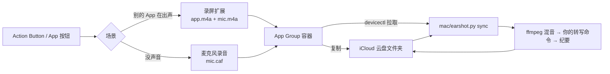

[English](README.md) · 简体中文

# Earshot：iPhone 录任意 App 的声音，Mac 上自动出文字稿和纪要

Earshot 是一个**只录声音的 iPhone 录音工具**：按一下 Action Button，录身边的对话，或者录手机正在播放的声音，
比如直播、视频、腾讯会议、Zoom、微信通话，画面一帧都不存。Mac 上的小脚本从 iCloud 收走录音，用你指定的
工具转成文字，再按场景写好纪要。

[](https://github.com/risingjerry/earshot-iphone-audio-recorder/actions/workflows/ci.yml)
[](LICENSE)


<p align="center"></p>

可以理解成 iPhone 上的 Audio Hijack，用的是苹果公开的录屏（ReplayKit）扩展接口。

## 快速开始

需要一台装了 Xcode 26+ 和 [XcodeGen](https://github.com/yonaskolb/XcodeGen) 的 Mac、一台 iOS 26+ 的 iPhone，
Xcode 里登录一个 Apple ID（免费的个人团队就够）。

```sh
git clone https://github.com/risingjerry/earshot-iphone-audio-recorder.git earshot && cd earshot
cp config.example.env config.local.env   # 填团队 ID、Bundle ID 前缀、iPhone 的 UDID
make ios-install                          # 编译、签名、装到手机并打开
```

手机上点「手机声音」，在系统面板里选 Earshot，点「开始直播」，然后去任意 App 放点声音。再点一次停止，
录音就出现在列表里，可以播放和分享。

## 能做什么

- **两种场景，一个按钮。**「现场对话」用麦克风录；「手机声音」录手机放出来的声音，可以顺便把你的麦克风也混进去。
- **Action Button 自己判断场景。** 有别的 App 在出声就录那个 App；没有就直接开始录现场对话，灵动岛显示计时。
  再按一次停止。
- **待命模式：真正按一下就录。** 录屏只开一次，之后一直在后台等着、什么都不存；每按一次 Action Button
  开始或结束一条录音，不弹面板、不用再点。
- **只存声音，被杀也不丢。** 画面直接丢弃；声音存 AAC，每 10 秒落一次盘（约 29 MB/小时），录音中途被系统
  关掉也只丢最后几秒。
- **自己跑到 Mac 上。** 每条录音会复制到你选的 iCloud 云盘文件夹；同一 Wi-Fi 下 Mac 也能用
  `xcrun devicectl` 直接拉。
- **纪要按场景写。** 现场对话写「谁说了什么 / 约定 / 待办」；视频、直播写「讲了什么 / 值得记的原话」；
  线上会议和通话会被识别出来，按对话来写。

## 原理



iPhone App 里没有任何联网代码。手机写什么、Mac 写回什么，都写在 [`docs/CONTRACT.md`](docs/CONTRACT.md)。

## 配置 Mac 端

需要 Python 3.11+、ffmpeg 和一个转写命令。纪要默认用 [Codex CLI](https://github.com/openai/codex) 写，
也可以换成任意命令。

```sh
python3 mac/earshot.py init-config   # 生成 ~/.config/earshot/config.json
$EDITOR ~/.config/earshot/config.json
python3 mac/earshot.py sync          # 处理一次已经录完的录音
make mac-install                     # launchd 任务：每 10 分钟一次，iCloud 文件夹有变化时立即处理
```

| 配置 | 含义 | 默认 |
|---|---|---|
| `transcribe_cmd` | **必填。** 命令数组，占位符 `{audio}`、`{out_dir}`；要在 out_dir 写出一个 `.md` 文字稿（`.srt` 可选）。本地示例：[`examples/transcribe-whisper.sh`](examples/transcribe-whisper.sh) | — |
| `icloud_dir` | 你在 App 里选的 iCloud 文件夹下的 `录音` 子文件夹 | `~/Library/Mobile Documents/com~apple~CloudDocs/Earshot/录音` |
| `device`、`app_group` | iPhone 的 UDID 和 `group.<前缀>.earshot`，填了就也走 Wi-Fi/数据线拉取 | 关闭 |
| `output_dir` | devicectl 拉来的录音放哪 | `~/Documents/Earshot` |
| `summary_cmd` / `summary_model` | 换掉 Codex 纪要，或设成 `[]` 不写纪要 | Codex CLI |

环境变量 `EARSHOT_DEVICE`、`EARSHOT_APP_GROUP`、`EARSHOT_ICLOUD_DIR`、`EARSHOT_OUTPUT_DIR`、`EARSHOT_CONFIG`
可以覆盖配置文件。密钥不进配置：转写命令自己去读自己的 key。

每条录音的文件夹最后会有 `纪要.md`、`文字稿.md`（带时间戳）、`文字稿.srt`（转写命令生成了才有）和原始音频。

## 配合 Claude Code、Codex 等 Agent 使用

仓库自带给 Agent 的说明（[`AGENTS.md`](AGENTS.md)）和一个技能，Agent 学会后能帮你找录音、同步、引用原话：

```sh
npx skills add risingjerry/earshot-iphone-audio-recorder
# 或者：cp -r skills/earshot ~/.claude/skills/
```

然后可以直接说：

- 「我今天下午录的那个会，最后定了什么？」
- 「同步一下手机录音，总结最新那条直播。」
- 「昨天那条录音为什么没有文字稿？」

## 限制

- **录别的 App 的声音，每次开录屏都要点一下。** 苹果规定每次录屏都必须由人确认，App 不能自己开始。
  待命模式让一次录屏一直开着，Action Button 就能按一下就录；代价是顶上红点常亮、多耗一点电。
  控制中心的录屏按钮**不会**记住 Earshot（iOS 27 实测轻点会存进相册）。
- **免费 Apple ID 的签名只有 7 天，一台手机最多装 3 个自签 App。** `make ios-resign-job` 会在手机可达时
  每 4 小时自动重签。
- 只支持 **iOS 26 及以上**的 iPhone。有版权保护（DRM）的视频可能录成静音。
- 录通话、录会议，很多地方要求所有人知情同意，录之前先问一声。

## 常见问题

### iPhone 能像 Mac 上的 Audio Hijack 那样录别的 App 的声音吗？
能。苹果的录屏（ReplayKit）扩展会把系统正在播放的声音交给扩展，Earshot 只留声音、丢掉画面。

### iPhone 上能录微信通话、腾讯会议、Zoom 吗？
能。实测录到了微信语音和视频通话、腾讯会议、抖音直播。想把自己的声音也录进去，在系统面板里打开麦克风。

### 为什么还要点一下「开始直播」？
苹果规定每次录屏都必须由人开始。打开待命模式，就变成每次开录屏点一次，而不是每条录音点一次。

### Earshot 会把我的录音上传到哪里吗？
不会。iPhone App 没有联网代码，录音只经过你自己的 iCloud 云盘文件夹，或局域网里的 `devicectl` 拉取到你的
Mac；之后怎么转写，取决于你配置的命令。

### 需要付费的苹果开发者账号吗？
不需要。Xcode 里登录免费 Apple ID 就能装，签名 7 天有效，开着重签任务就行。

### 怎么让每条录音自动出文字稿和纪要？
在 `~/.config/earshot/config.json` 里设好 `transcribe_cmd`，再运行 `make mac-install`。新录音 10 分钟内处理完，
放进 iCloud 文件夹时会立即处理。

## 卸载

先在 iPhone 上删除 App，再在 Mac 上：

```sh
mac/uninstall-launchd.sh
launchctl bootout gui/$(id -u)/dev.earshot.resign; rm -f ~/Library/LaunchAgents/dev.earshot.resign.plist
rm -rf ~/.config/earshot "~/Library/Application Support/earshot"
```

iCloud 文件夹里的录音不会被删，需要的话自己删。

## 贡献、安全、许可证

[贡献指南](CONTRIBUTING.md) · [安全策略](SECURITY.md) · [MIT 许可证](LICENSE)

如果 Earshot 帮你省下了一次会议记录，点个 ⭐ 能让更多人找到它。

[](https://star-history.com/#risingjerry/earshot-iphone-audio-recorder&Date)
